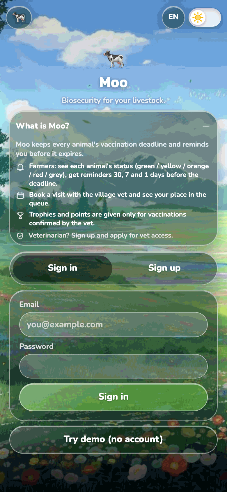
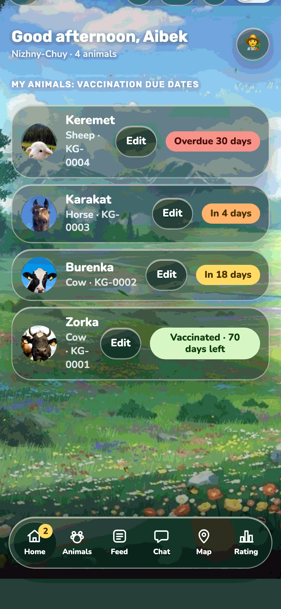
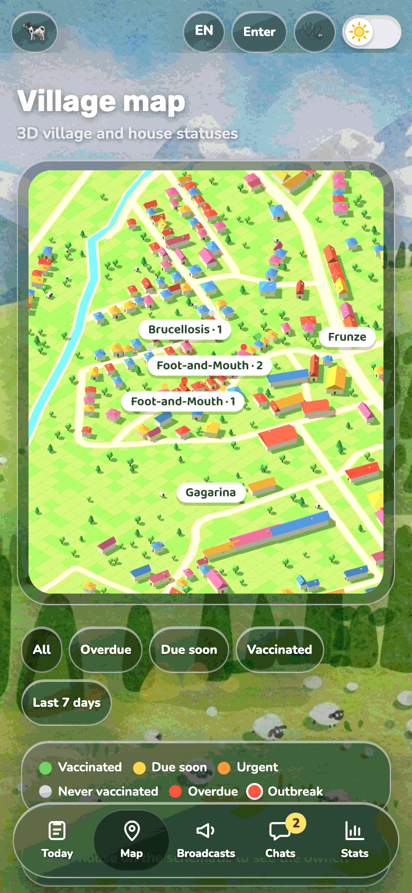
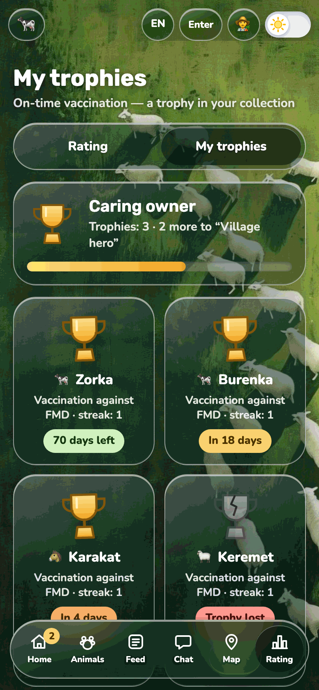
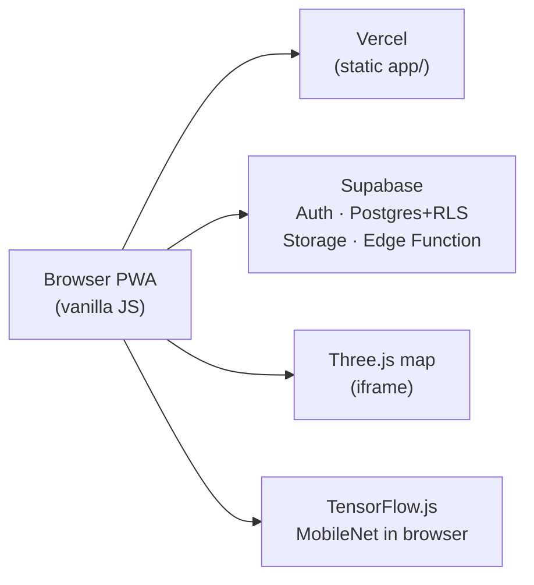

# Moo 🐄

Livestock biosecurity PWA — digital vet passports, FMD vaccination deadlines, booking with the village vet, and trophies only for vet-confirmed vaccinations.


**Live demo:** [https://mooo-nine.vercel.app](https://mooo-nine.vercel.app) — tap **Try demo (no account)**. All users and animals in the demo are fictional.

## Screenshots

<table>
  <tr>
    <td align="center"><br><sub>Sign in</sub></td>
    <td align="center"><br><sub>Farmer home</sub></td>
    <td align="center"><br><sub>Vet map</sub></td>
    <td align="center"><br><sub>Trophies</sub></td>
  </tr>
</table>

## Table of contents

1. [What it does](#what-it-does)
2. [How it works](#how-it-works)
3. [Roles and permissions](#roles-and-permissions)
4. [Security model](#security-model)
5. [Getting started](#getting-started)
6. [Demo mode](#demo-mode)
7. [Testing](#testing)
8. [Deployment](#deployment)
9. [Recognition](#recognition)
10. [3D village map](#3d-village-map)
11. [Project structure](#project-structure)
12. [i18n, PWA, accessibility](#i18n-pwa-accessibility)
13. [Limitations and roadmap](#limitations-and-roadmap)
14. [Devpost Learn Skill Pack](#built-with-the-devpost-learn-skill-pack)
15. [License](#license)

## What it does

### Farmer

- Digital vet passport per animal (photo, ear tag, vaccination history, health journal).
- FMD status at a glance: green / yellow / orange / red / grey (`ok` / `soon` / `urgent` / `overdue` / `never`).
- Reminders at 30 / 7 / 1 days before expiry; book a reception slot and get a queue number.
- Private chat with the vet; village feed; muzzle scan to identify an animal; trophies only after vet confirmation.

### Vet

- Today queue (mark Vaccinated / No-show); publish slots; segment broadcasts; farmer chats; village stats.
- 3D map with house vaccination colors and outbreak markers (vet only).

### Admin (project owner)

- Reviews pending vet applications (approve → `profiles.role = vet`, or reject).

### Vet application (once)

Everyone signs up with email + password. Choosing “I am a veterinarian” also requires a license photo and an individual access code issued by the project owner. The Edge Function checks the code server-side; the admin reviews the application manually until the project receives funding. Until approved, the account uses the farmer cabinet with an under-review banner.

## How it works



**Core flow:** farmer books a slot → gets a queue number → vet marks Vaccinated → a `verified` vaccination is written → status turns green and a trophy / points are awarded. Self-mark is `claimed` only and awards zero points.

## Roles and permissions

Derived from RLS policies in `supabase/sql/002_booking_vaccinations.sql`, `supabase/sql/003_auth_roles_vet_applications.sql`, `supabase/sql/004_vet_code_and_masking.sql`.

| Resource | Farmer | Vet | Admin |
| --- | --- | --- | --- |
| Own profile | read/write (role change blocked) | same | same |
| `profiles.role` | cannot self-promote | cannot self-promote | set via `review_vet_application` or SQL |
| Animals | CRUD own; read others via `animals_public` | same + see vaccinations/health | — |
| Slots | read; book | create/update own | — |
| Bookings | own read/insert/update | read/update all for slots | — |
| Vaccinations | insert `claimed` for own animals | insert/update `verified` | — |
| Broadcasts | read | insert | — |
| Messages | village + own vet thread | all threads | — |
| `vet_applications` | read own (insert via Edge Function only) | — | read + review |
| `vet-licenses` Storage | upload/read own folder | — | read all |
| Admin UI | — | — | pending applications |

## Security model

- **RLS** on every public table; anon cannot read sensitive rows (verified by `tests/rls/rls.mjs`).
- **`animals_public` view** masks neighbour `notes` / `reminders`; `vaccinations` / `health` only for owner or vet (`supabase/sql/004_vet_code_and_masking.sql`).
- **`protect_profile_role` trigger** forces new profiles to `farmer` and blocks client role changes unless `moo.allow_role_change` is set inside `review_vet_application`. Clients can never set `admin`.
- **Vet invite code** lives only as Edge Function secret `VET_INVITE_CODE` (set in Supabase Dashboard → Edge Functions → Secrets). Compared with a constant-time check; failed attempts rate-limited (5 / hour) in `vet_code_attempts` (service role only).
- **License photos** in private bucket `vet-licenses`.
- **No secrets in the repo.** `app/supabase-config.js` holds the public project URL and publishable (anon) key; RLS protects data. Honest limits: animal photos are often data URLs in Postgres; outbreak pins are demo constants, not a table.

## Getting started

### Prerequisites

- Python 3 (or any static file server).
- Camera (phone or webcam) and internet on first load (MobileNet CDN + Supabase).

### Run locally

```bash
cd app
npm start
# same as: python3 -m http.server 8000 --bind 127.0.0.1
```

Open [http://127.0.0.1:8000](http://127.0.0.1:8000). Use **Try demo** or Sign up / Sign in.

### Supabase setup

Apply SQL in order (SQL editor or `psql`):

1. `supabase/sql/001_baseline.sql` — baseline (profiles, animals, posts, messages, activity_log) if the project is empty.
2. `supabase/sql/002_booking_vaccinations.sql` — slots, bookings, vaccinations, broadcasts, `book_slot`, points trigger.
3. `supabase/sql/003_auth_roles_vet_applications.sql` — admin role, `vet_applications`, `vet-licenses` bucket, `review_vet_application`, `protect_profile_role`.
4. `supabase/sql/004_vet_code_and_masking.sql` — `vet_code_attempts`, drop client `submit_vet_application` RPC, `animals_public` masking.

Deploy the Edge Function:

```bash
# from a machine with Supabase CLI linked to the project
supabase functions deploy submit-vet-application
```

Set secret name `VET_INVITE_CODE` in the dashboard (value issued by the project owner — never commit it). Put the project URL and publishable anon key in `app/supabase-config.js`.

Promote the first admin after that user signs up (SQL editor / service role):

```sql
update public.profiles set role = 'admin' where id = '<user-uuid>';
```

Without Supabase, or if tables are missing, `app/store.js` falls back to `localStorage`.

### Config: public vs secret

| Name | Where | Public? |
| --- | --- | --- |
| Supabase URL + anon/publishable key | `app/supabase-config.js` | Yes (browser) |
| `VET_INVITE_CODE` | Edge Function secrets; documented in `.env.example` for local tests | No |
| Service role key | Supabase only (Edge Function runtime) | No |

## Demo mode

**Try demo** sets `moo_demo_mode` and forces local mode — it never writes to Supabase.

Seeded (fictional), **localized for the current UI language** (`app/demo-content.js` + `app/mock.js`):

- Four animals covering green / yellow / orange / red (photos under `app/img/demo-*.jpg`); English names e.g. Zorka, Burenka, Karakat, Keremet.
- Demo farmers, feed posts, chats, places, and the vet display name follow ru / ky / en.
- One reception slot on the feed; farmer↔vet role switch in the header.
- Vet map: 16 house pins on real building footprints + outbreaks (`app/vet.js` `DEMO_HOUSE_PINS` / `DEMO_OUTBREAKS`); map chrome and place labels follow `moo:lang`.

## Testing

From `tests/` (after `npm install` there):

```bash
cd tests
npm install

# Pure logic + auth helpers (no network)
npm run unit

# Supabase RLS (needs project + test users; no secrets printed)
npm run rls

# Playwright smoke against a local server (system Chrome; skips browser download)
npm run e2e
```

Additional scripts (run with `node`):

- `e2e/auth-welcome.mjs` — auth welcome block screenshots → `tests/screens/auth-welcome/`
- `e2e/demo-statuses.mjs` — status colors → `tests/screens/demo-statuses/`
- `e2e/demo-map-placement.mjs` — demo map pins on houses → `tests/screens/demo-map/`
- `e2e/en-no-cyrillic.mjs` — English demo UI must contain no Cyrillic (all tabs + map iframe); RU still has Cyrillic
- `e2e/readme-screenshots.mjs` — regenerate README PNGs in `docs/screenshots/`

Reports: `tests/TEST-REPORT.md` … `tests/TEST-REPORT-4.md`. Playwright writes generated screenshots under `tests/screens/` (gitignored; recreated by the e2e scripts). README images live in `docs/screenshots/`.

**What the runs found:** two critical RLS holes — clients could self-promote to `vet`, and neighbours could read vaccination history — fixed with `protect_profile_role` and `animals_public` (see `tests/TEST-REPORT.md`, working SQL in `supabase/sql/004_vet_code_and_masking.sql`).

### Migration file history

| Old path | New path |
| --- | --- |
| `supabase/schema.sql` | `supabase/sql/001_baseline.sql` |
| `schema-v2.sql` | `supabase/sql/002_booking_vaccinations.sql` |
| `schema-v3-auth.sql` | `supabase/sql/003_auth_roles_vet_applications.sql` |
| `schema-v4-vet-code.sql` | `supabase/sql/004_vet_code_and_masking.sql` |

Files live under `supabase/sql/` (not `supabase/migrations/`) so the Supabase CLI does not treat them as timestamped migrations. SQL contents are unchanged from what was applied live.

## Deployment

Hosted on **Vercel** as static files from `app/` (live: [mooo-nine.vercel.app](https://mooo-nine.vercel.app)). There is no `vercel.json` in the repo — set the project Root Directory to `app` in the Vercel dashboard (or equivalent CLI link). Redeploy by pushing to the connected Git branch or triggering a dashboard redeploy.

Service worker (`app/sw.js`, cache `moo-v34`) network-first caches the app shell, including `village-map.html` and `three.min.js`. It never falls back iframe navigations to `index.html` (avoids the offline “mirror tunnel”).

## Recognition

There is no free animal Face-ID API. Moo uses **MobileNet v2** (TensorFlow.js) in the browser: a muzzle close-up → 1280-number embedding. Registration averages frames; a species gate reduces cow/sheep/horse mix-ups; a match needs similarity ≥ threshold **and** margin over the second-best candidate.

Constants in `app/recognition.js` (measured with `tools/calibrate.html` on real animal photos):

| Constant | Value | Meaning |
| --- | --- | --- |
| `MATCH_THRESHOLD` | 0.53 | cosine similarity for “found it” |
| `MATCH_MARGIN` | 0.05 | best must beat 2nd best |
| `SPECIES_CONFIDENCE` | 0.35 | trust `mobilenet.classify` species |
| `FRAMES_TO_CAPTURE` | 3 | frames averaged at registration |

### Calibration (animal photos)

Photos: **6** of the **same cow** (angles), **5** of **other animals**.

| Distribution | n | min | median | mean | max |
| --- | --- | --- | --- | --- | --- |
| Genuine (same animal) | 15 | 0.5192 | 0.6552 | 0.6572 | 0.9004 |
| Impostor (different) | 30 | 0.2997 | 0.4174 | 0.4170 | 0.5205 |

Tails nearly touch (genuine min ≈ impostor max). Shipped **0.53 / 0.05** prefers fewer false IDs. Re-run `tools/calibrate.html` anytime.

### Limitations

MobileNet is a classifier, not a metric face model. Different individuals of the same species can be close in embedding space. The demo is honest for village scale, not a national registry.

## 3D village map

The Map tab loads `app/village-map.html` in an iframe (local `three.min.js`). The parent sends GPS via `postMessage({ type: 'gps', lon, lat })` and vet overlays via `moo:overlay` (`app/vet.js` `sendMapOverlay`). Farmers receive empty house/outbreak lists.

To swap the village:

1. Place GeoJSON as `export.geojson` in the **repo root** (gitignored).
2. From the repo root run `python3 tools/prep_village_data.py` → writes `data.json` (gitignored; the `D` constant).
3. Replace `D = {…}` in `app/village-map.html` and update labels as needed.

## Project structure

```
README.md
LICENSE
scope.md
prd.md
spec.md
skills-lock.json
.env.example
.gitignore
app/                          # PWA (Vercel root)
├── index.html
├── styles.css                # design system
├── app.js
├── store.js
├── logic.js
├── auth-logic.js
├── rewards.js
├── recognition.js
├── vet.js
├── mock.js, demo-content.js
├── camera.js, loader.js, i18n.js, supabase.js, supabase-config.js
├── village-map.html, three.min.js
├── sw.js, manifest.webmanifest, icons/, img/
├── package.json
supabase/
├── config.toml
├── functions/submit-vet-application/
└── sql/
    ├── 001_baseline.sql
    ├── 002_booking_vaccinations.sql
    ├── 003_auth_roles_vet_applications.sql
    └── 004_vet_code_and_masking.sql
tests/
├── unit/
├── rls/
├── e2e/
├── screens/                  # generated by e2e (gitignored)
├── TEST-REPORT*.md
├── package.json
└── README.md
tools/
├── calibrate.html
├── prep_village_data.py
└── README.md
docs/
└── screenshots/
devpost/
.claude/
.agents/
```

## i18n, PWA, accessibility

- Languages: Russian (default), Kyrgyz, English (`app/i18n.js` `LANGS`). Demo fiction and the 3D map UI track the same language; English place labels are transliterated (geometry data unchanged).
- PWA: `manifest.webmanifest` + service worker registered on boot; network-first offline shell (`moo-v35`).
- Accessibility present in code: `aria-label` / `aria-checked` on chrome controls, `role="status"` toasts, `role="progressbar"` on the village bar, `prefers-reduced-motion` on the map.

## Limitations and roadmap

- Outbreak markers are constants in `app/vet.js`, not a database table.
- Animal photos often stored as data URLs in Postgres (license photos already use Storage).
- No production push server (SW has a push/notification stub only).
- No native app; offline chat is not a full offline client; map needs a connection the first time.
- Vet access codes are issued and applications reviewed manually by the project owner until funding.

**Later:** Storage for all photos; outbreaks table + RLS; offline recognition; admin assistant for codes; real push; native app.

## Built with the Devpost Learn Skill Pack

Planning followed the Devpost Learn “Build With AI: Basics” skills (`skills-lock.json`). Working copies of the planning docs live under `devpost/` — keep them **byte-identical** to the root `scope.md`, `prd.md`, and `spec.md`.

- [`devpost/scope.md`](devpost/scope.md) · [`devpost/prd.md`](devpost/prd.md) · [`devpost/spec.md`](devpost/spec.md)
- [`devpost/checklist.md`](devpost/checklist.md) · [`devpost/app-map.html`](devpost/app-map.html)

## License

[Apache License 2.0](LICENSE).
